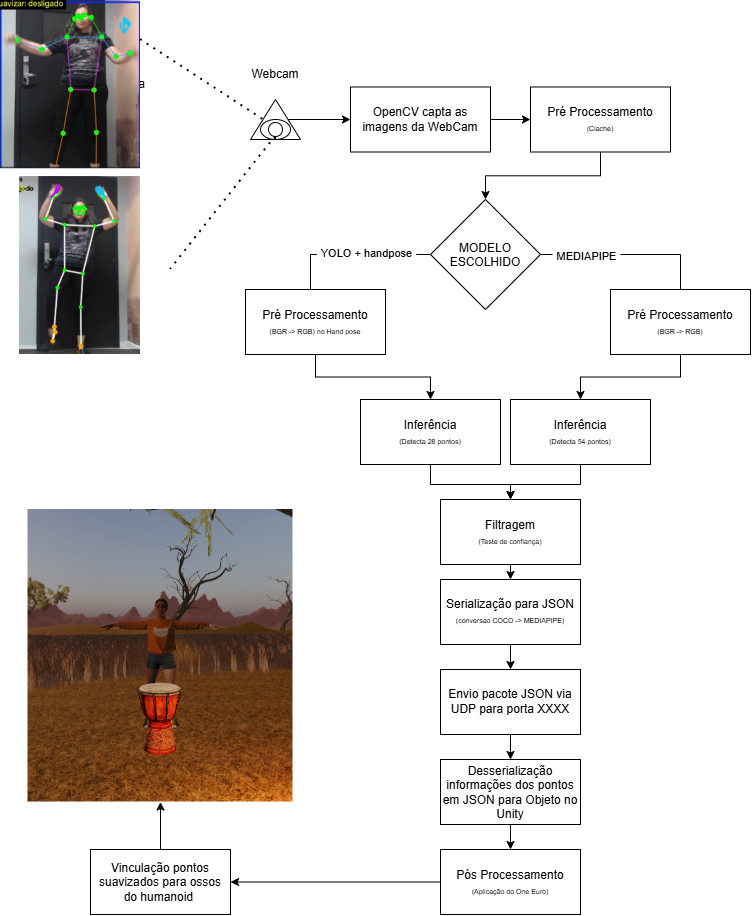

# Rastreamento de pose corporal em tempo real para performances musicais imersivas

Captura do corpo inteiro de um músico por uma webcam, com **visão computacional** (YOLO26-pose e MediaPipe),
e envio dos pontos do esqueleto em tempo real, via **UDP**, para um avatar 3D no motor de jogos **Unity**
(Editor no PC ou Meta Quest 3S).



---

## Sumário

1. [Introdução](#1-introdução)
2. [Desenvolvimento e técnicas utilizadas](#2-desenvolvimento-e-técnicas-utilizadas)
3. [Resultados](#3-resultados)
4. [Como executar](#4-como-executar)
5. [Estrutura do projeto](#5-estrutura-do-projeto)
6. [Referências](#6-referências)

---

## 1. Introdução

### 1.1 O problema

Em **apresentações musicais imersivas** (realidade virtual), quem assiste não vê o músico de verdade, e sim um
**avatar** que repete os movimentos dele. A expressividade corporal faz parte da performance: os gestos das mãos,
o balanço do tronco, a cabeça e os pés marcando o ritmo. Se o avatar perde parte desses movimentos, a experiência
de quem assiste fica menos realista, e o próprio músico perde a sensação de "estar" no corpo virtual.

### 1.2 A motivação: o projeto *Djembefola*

Este trabalho nasceu de um problema real em outro projeto, o **Djembefola**, uma experiência em VR na qual um
músico toca djembê. Nele, o avatar era controlado **apenas pelo headset**: a cabeça pelo próprio headset e as mãos
pelo *hand tracking* das câmeras do Meta Quest.

Essa solução tem duas limitações:

1. **Perda das mãos no "modo flow".** Quando o músico se empolga e entra no estado de *flow*, os movimentos ficam
   amplos e rápidos, e as mãos saem do campo de visão das câmeras do headset, ou ficam borradas. O rastreamento
   das mãos falha justamente nos momentos mais expressivos da performance, e o avatar perde os movimentos.
2. **Sem corpo.** O headset não enxerga o tronco, as pernas nem os pés. O público vê só uma cabeça e duas mãos
   flutuando.

### 1.3 A aplicação desenvolvida

A proposta é adicionar uma **webcam externa**, posicionada de frente para o músico, e estimar a **pose do corpo
inteiro** com modelos de visão computacional. A webcam tem uma visão "de fora" do músico, então:

- **as mãos continuam visíveis** quando saem do campo das câmeras do headset; o Unity usa a webcam como
  **reserva** e troca de uma fonte para a outra com uma transição suave;
- **o corpo inteiro entra na experiência**: tronco, braços, pernas e pés passam a mover o avatar, e quem assiste
  vê uma performance mais completa e realista.

O sistema tem duas partes que conversam pela rede:

| Parte | Onde roda | Papel |
|---|---|---|
| **Python** (este repositório) | PC com a webcam | Captura a imagem, detecta o corpo e as mãos, filtra e envia os pontos |
| **Rede (UDP)** | PC → Unity | Uma mensagem JSON por quadro, na porta 5052 |
| **Unity** (repositório `UnityBodyTracking`) | Editor no PC ou app no Meta Quest 3S | Suaviza os pontos e transforma em rotações dos ossos do avatar |

Foram implementadas **duas soluções alternativas** de estimativa de pose, com o mesmo formato de saída. Assim é
possível comparar os dois modelos sem mudar nada no Unity:

| | `pose_YOLO_real_time.py` (foco do trabalho) | `pose_MEDIAPIPE_real_time.py` |
|---|---|---|
| Corpo | **YOLO26n-pose**: 17 pontos 2D (padrão COCO) | **MediaPipe Pose Landmarker**: 33 pontos 3D |
| Mãos | MediaPipe Hand Landmarker (21 pontos por mão), em paralelo | MediaPipe Hand Landmarker |
| Rosto | não tem | MediaPipe Face Landmarker: 52 expressões (opcional) |
| Execução | GPU (CUDA), com fallback para CPU | CPU |

---

## 2. Desenvolvimento e técnicas utilizadas

O fluxo completo, etapa por etapa, está no fluxograma detalhado
([docs/Images/FluxogramaDetalhado.png](docs/Images/FluxogramaDetalhado.png)) e descrito em
[docs/fluxo_processamento.md](docs/fluxo_processamento.md). A seguir, as técnicas de cada etapa.

### 2.1 Captura da imagem

- A webcam é lida com o **OpenCV** (`cv2.VideoCapture`, com o backend DirectShow no Windows), em 640×480.
- O **horário da captura** (`time.time()`) é gravado logo depois da leitura do quadro, antes da inferência, e vai
  no campo `"t"` da mensagem. Assim, o intervalo entre dois quadros (`dt`), usado pelo filtro de suavização no
  Unity, é o intervalo real entre as capturas da câmera, sem a variação do tempo de inferência.
- O espelhamento da imagem fica **desligado**: em primeira pessoa, no VR, a mão direita do músico tem que mover a
  mão direita do avatar.

### 2.2 Pré-processamento: realce em pouca luz (CLAHE)

Arquivo: [rastreamento/filtros_pose.py](rastreamento/filtros_pose.py) (`pre_processar`).

Apresentações costumam ter **iluminação baixa ou cênica**, o que reduz a confiança dos modelos. Por isso:

1. o sistema mede o **brilho médio** do quadro, em tons de cinza (0 a 255);
2. se o brilho estiver abaixo de **90**, aplica o **CLAHE** (*Contrast Limited Adaptive Histogram Equalization*):
   - equaliza o histograma em pequenas regiões (grade 8×8), realçando o contraste local;
   - limita o ganho (*clip limit* 2,0) para não amplificar o ruído do sensor;
   - é aplicado só no canal **L** (luminosidade) do espaço de cor **LAB**, então a imagem clareia sem distorcer as
     cores;
3. em ambiente claro, o quadro segue sem mudanças (não gasta processamento à toa).

Os modelos do MediaPipe recebem também a conversão de cor BGR → RGB.

### 2.3 Estimativa de pose (inferência)

**YOLO26n-pose** ([pose_YOLO_real_time.py](pose_YOLO_real_time.py)), via biblioteca Ultralytics:

- modelo *single-stage*: detecta a pessoa e os **17 pontos-chave** do padrão COCO (nariz, olhos, orelhas, ombros,
  cotovelos, pulsos, quadris, joelhos, tornozelos) numa única passada da rede, com uma **confiança** de 0 a 1 por
  ponto;
- versão *nano* (`n`), a menor da família, escolhida para caber no orçamento de tempo real; roda na **GPU** (CUDA);
- o YOLO **não tem dedos**, então o **MediaPipe Hand Landmarker** (21 pontos por mão) roda **em paralelo**, numa
  segunda *thread*. O tempo das mãos não se soma ao do corpo.

**MediaPipe** ([pose_MEDIAPIPE_real_time.py](pose_MEDIAPIPE_real_time.py)):

- **Pose Landmarker** (*BlazePose*, versão `lite`): 33 pontos do corpo, incluindo calcanhares, pontas dos pés e
  pontos das mãos, já em **3D e em metros**, com centro no quadril (*world landmarks*);
- **Hand Landmarker** e, opcionalmente, **Face Landmarker**, rodando em paralelo sobre o mesmo quadro;
- execução no modo `VIDEO`, que usa o resultado do quadro anterior para rastrear (*tracking*) em vez de detectar
  do zero a cada quadro.

### 2.4 Filtro por confiança com tolerância

Arquivo: [rastreamento/filtros_pose.py](rastreamento/filtros_pose.py) (`FiltroPontos`).

Os modelos às vezes "perdem" um ponto por um único quadro (borrão de movimento, oclusão). Para cada ponto:

- só é aceito se a confiança (YOLO) ou a visibilidade (MediaPipe) for **≥ 0,5**;
- se não for aceito, o filtro **repete o último valor bom por até 5 quadros**, e o membro do avatar não "pisca";
- depois de 5 quadros, o ponto é marcado como **perdido** (visibilidade 0), e o Unity passa a ignorá-lo.

### 2.5 Associação das mãos ao corpo

Arquivo: [rastreamento/maos_mediapipe.py](rastreamento/maos_mediapipe.py).

O detector de mãos não sabe a qual corpo cada mão pertence. Cada mão detectada é associada ao **pulso do corpo
mais próximo** (pulso esquerdo → `"lh"`, pulso direito → `"rh"`). Uma mão a mais de **0,2** do tamanho da imagem
do pulso é descartada (provavelmente é de outra pessoa ou um falso positivo).

### 2.6 Conversão YOLO → formato MediaPipe e estimativa de profundidade (pseudo-3D)

Arquivos: [rastreamento/pontos_pose.py](rastreamento/pontos_pose.py) e
[rastreamento/envio_unity.py](rastreamento/envio_unity.py) (`ConversorCOCO`).

Para o Unity receber sempre o mesmo formato, os 17 pontos 2D do YOLO viram os 33 pontos 3D do MediaPipe:

1. **Mapeamento de índices:** cada ponto COCO vai para a posição de mesmo nome no MediaPipe. Os pontos que o YOLO
   não tem (cantos dos olhos, boca, calcanhares, pontas dos pés) vão com visibilidade 0.
2. **Pixels → metros:** a escala vem de medidas antropométricas médias de um adulto: largura dos ombros (0,36 m) e
   altura do tronco (0,50 m). Usa a **maior** das duas estimativas, porque girar o corpo só encurta as medidas na
   imagem. A escala muda aos poucos (média móvel exponencial), para o corpo não "pulsar" de tamanho.
3. **Centro no quadril**, igual ao MediaPipe. Sem os quadris na imagem (músico sentado atrás do instrumento), o
   centro é estimado abaixo dos ombros.
4. **Profundidade (z) pelo encurtamento dos ossos:** um osso que aparece **mais curto** na imagem do que o seu
   comprimento real está apontando para a câmera. Com o comprimento real `L` e o comprimento na imagem `l`:

   ```
   profundidade = √(L² − l²)
   ```

   `L` é o maior comprimento visto recentemente (com um "esquecimento" lento), então o sistema se adapta a pessoas
   maiores ou menores que a média. Ossos com 95% ou mais do comprimento real são tratados como paralelos à imagem
   (z = 0), para o ruído não virar profundidade.

### 2.7 Mensagem e transmissão em rede (UDP)

Arquivo: [rastreamento/envio_unity.py](rastreamento/envio_unity.py) (`EnviadorUnity`).

Os dois scripts montam a mesma mensagem JSON:

```json
{
  "src": "yolo",              // ou "mediapipe"
  "frame": 1234,              // número do quadro
  "t": 1764090000.123,        // horário da captura (s)
  "detected": true,           // false = ninguém na imagem
  "w": 640, "h": 480,         // tamanho da imagem
  "lm":  [x, y, z, vis, ...], // 33 pontos na imagem (0 a 1) + visibilidade
  "wlm": [x, y, z, ...],      // 33 pontos em metros
  "lh":  [x, y, z, ...],      // mão esquerda: 21 pontos
  "rh":  [x, y, z, ...]       // mão direita: 21 pontos
}
```

- **Protocolo UDP, um datagrama por quadro, porta 5052.** Em tempo real, um pacote atrasado já não serve. O UDP
  não espera reenvio, então a pose mais nova sempre passa na frente (ao contrário do TCP, que bloquearia a fila
  esperando um pacote perdido).
- **Descoberta automática:** o Unity avisa "estou aqui" a cada 1 s (porta 5053), o PC responde por *broadcast*, e
  passa a enviar direto para o IP de cada Unity ativo. Funciona com o Unity no mesmo PC (`127.0.0.1`, Quest pelo
  cabo Link) ou com o app instalado no Quest, pela rede Wi-Fi.

### 2.8 Pós-processamento no Unity: filtro One Euro

Arquivo (no projeto Unity): `OneEuroFilter.cs`.

Os pontos dos modelos **tremem** um pouco de um quadro para outro, mesmo com a pessoa parada. Uma média móvel
tira o tremor, mas **atrasa** o movimento, o que é ruim para um músico (o gesto do avatar ficaria fora do tempo da
música). O **filtro One Euro** (Casiez et al., 2012) é um passa-baixa **adaptativo**: a frequência de corte muda
conforme a velocidade do ponto.

```
cutoff = minCutoff + β · |velocidade|
τ      = 1 / (2π · cutoff)
α      = 1 / (1 + τ / dt)
x̂     ← x̂ + α · (x − x̂)
```

- **Parado:** cutoff baixo, `α` pequeno → suaviza bastante e **tira o tremor**.
- **Movimento rápido** (uma batida no djembê): cutoff alto, `α` perto de 1 → quase não suaviza e **não atrasa**.

Valores atuais: `minCutoff = 1,5` e `β = 5`, ajustáveis no Inspector do Unity
(roteiro de ajuste em [docs/ajuste_one_euro.md](docs/ajuste_one_euro.md)). No Python a suavização fica desligada
(`SUAVIZAR = False`): suavizar nos dois lados somaria o atraso, e no Unity o filtro também suaviza a troca entre as
mãos do headset e as da webcam.

### 2.9 Animação do avatar Humanoid no Unity

Arquivo (no projeto Unity): `HumanoidAvatarDriver.cs`.

O modelo entrega **posições**, mas o esqueleto de um avatar recebe **rotações**. A técnica é *retargeting* por
direção:

1. Na inicialização, guarda a **pose de repouso** de cada osso: rotação e direção até o osso filho.
2. A cada quadro, cada osso é girado da direção de repouso até a **direção entre dois pontos** detectados (por
   exemplo, braço = ombro → cotovelo), com a menor rotação possível (`Quaternion.FromToRotation`). O comprimento
   dos ossos continua sendo o do modelo 3D, então funciona com avatares de qualquer proporção.
3. Os ossos são resolvidos **do tronco para as pontas** (quadril → coluna → braços → mãos → dedos), e cada filho
   herda a rotação do pai.
4. **Braços com IK de dois ossos** (lei dos cossenos): a mão do avatar é levada até onde está o pulso do músico,
   na escala do avatar; o cotovelo detectado só indica para que lado o braço dobra.
5. **Partes pouco visíveis** (visibilidade < 0,5) seguram a última pose boa por 0,6 s e depois voltam suavemente à
   pose de repouso, em vez de tremer.
6. **Pés no chão:** a altura do quadril é ajustada para o pé mais baixo tocar o chão.

**Fusão das mãos (o ponto central para o Djembefola):** o componente `HandTrackingSource.cs` tem o modo
**Automático**: usa o *hand tracking* do Quest enquanto o headset vê a mão e passa para a mão da **webcam** quando
ela sai do campo de visão do headset, com transição suave.

---

## 3. Resultados

### 3.1 Ambiente de teste

| Item | Configuração |
|---|---|
| Computador | Notebook com GPU NVIDIA GeForce RTX 3050 6 GB (Laptop) |
| Software | Python 3.14, PyTorch 2.14 (CUDA 13.0), Ultralytics 8.4, MediaPipe 1.2.2, OpenCV 5.0 |
| Câmera | webcam do notebook, 640×480 |
| Visualização | Unity 6 (Editor) e Meta Quest 3S pelo cabo Link |

### 3.2 Tempo de inferência por modelo

Medição *offline* dos modelos sobre os **mesmos 384 quadros** de uma gravação de teste
(redimensionados para 640×480), descartando os 15 primeiros quadros (aquecimento):

| Modelo | Dispositivo | Média | Mediana | p95 | Taxa máx. teórica |
|---|---|---|---|---|---|
| **YOLO26n-pose** | **GPU** | **26,7 ms** | 23,3 ms | 33,1 ms | **~37 FPS** |
| YOLO26n-pose | CPU | 121,0 ms | 120,9 ms | 168,9 ms | ~8 FPS |
| MediaPipe Pose `lite` | CPU | 26,5 ms | 25,2 ms | 36,3 ms | ~38 FPS |
| MediaPipe Pose `full` | CPU | 40,6 ms | 37,0 ms | 62,0 ms | ~25 FPS |
| MediaPipe Hands (2 mãos) | CPU | 50,2 ms | 51,3 ms | 79,2 ms | ~20 FPS |

Observações:

- O YOLO26n-pose detectou a pessoa em 100% dos quadros. O MediaPipe Pose detectou em 100% (`lite`) e 96% (`full`).
- As mãos foram detectadas em apenas 40% dos quadros desta gravação. Ela é uma **gravação de tela**, na qual a
  pessoa aparece pequena; esse número **não representa** a taxa de detecção com a webcam ao vivo.
- Como o detector de mãos roda **em paralelo** com o corpo, o tempo por quadro do script YOLO fica perto do mais
  lento dos dois (≈ 50 ms), e não da soma (≈ 77 ms).
- Na **CPU**, o YOLO fica abaixo de 10 FPS: a **GPU é necessária** para a versão YOLO em tempo real.

### 3.3 Taxa e regularidade dos quadros (medido via UDP)

Medição feita em 25/11/2026 recebendo as mensagens UDP, em blocos de 90 pacotes, comparando o `dt` pelo campo
`"t"` (horário da captura) com o `dt` pela hora de chegada:

| Script | `dt` médio | Taxa | Desvio pelo `"t"` | Desvio pela chegada |
|---|---|---|---|---|
| YOLO | 65,9 a 66,9 ms | **~15 FPS** | 6,3 a 8,2 ms | 6,8 a 9,9 ms |
| MediaPipe | 66,6 a 66,9 ms | **~15 FPS** | 6,1 a 7,1 ms | 6,6 a 8,8 ms |

- Os **dois modelos ficaram em ~15 FPS**, embora a inferência permita mais de 20 FPS. O gargalo é a **webcam do
  notebook**, que entrega só 15 FPS (provavelmente pela exposição automática em pouca luz), e não o modelo.
- O desvio medido pelo `"t"` é **menor** que o medido pela chegada, e na chegada aparecem intervalos de até
  97–109 ms. Isso confirma a decisão de gravar o horário na captura e usá-lo como `dt` do filtro One Euro: a
  irregularidade da rede e do agendamento não entra no filtro.
- Intervalos inválidos (de 0,5 s a 34 s) só aconteceram ao **iniciar ou trocar** de script; nesses casos o Unity
  volta automaticamente para a hora de chegada.

### 3.4 Desempenho do lado Unity / VR

Com o avatar no Meta Quest 3S pelo cabo Link, o Unity rodava a **6 FPS**. Depois de desligar efeitos pesados de
renderização (SSAO, HDR, sombras suaves, cascatas de sombra), passou a **~70 FPS**, perto da taxa do headset
(72 Hz). O rastreamento em si não era o gargalo.

### 3.5 Análise crítica

**O que funcionou bem**

- **Tempo real na GPU:** a inferência do YOLO26n-pose (26,7 ms) cabe com folga no intervalo da câmera (66,7 ms).
- **Arquitetura desacoplada:** os dois modelos geram a mesma mensagem, então o Unity não precisa saber qual está
  rodando e é possível comparar os dois sem mudar nada no avatar.
- **Robustez a falhas curtas:** a tolerância de 5 quadros no Python, mais o *hold* de 0,6 s no Unity, evita que um
  quadro ruim faça o membro do avatar "cair".
- **Mãos de reserva para o VR:** a webcam cobre exatamente o caso que motivou o trabalho (mãos fora da visão do
  headset no modo *flow*).

**Limitações**

- **Taxa da câmera (15 FPS):** com movimentos rápidos, como as batidas no djembê, 15 FPS deixa o movimento menos
  fluido e aumenta o borrão. A troca por uma webcam melhor, já prevista, deve trazer o maior ganho de qualidade.
- **YOLO é 2D:** a profundidade é **estimada**, e o sinal é ambíguo (o osso pode apontar para a câmera ou para trás;
  o sistema assume para a câmera). Ombros e quadris ficam com z = 0, então o avatar não acompanha bem quando o
  músico gira o tronco de lado para a câmera.
- **Menos pontos no YOLO:** sem calcanhares e pontas dos pés, o osso do **pé** do avatar fica na pose de repouso;
  sem pontos do rosto, a cabeça é estimada só pelas orelhas e ombros.
- **Mãos dependem do tamanho na imagem:** com o músico longe da câmera, as mãos ficam pequenas e a detecção cai
  (como visto na gravação de teste). O enquadramento da webcam importa.
- **Ajuste do One Euro ainda em andamento:** os valores atuais são um ponto de partida; o roteiro de testes
  comparativos (YOLO × MediaPipe) está em [docs/ajuste_one_euro.md](docs/ajuste_one_euro.md), e os ajustes feitos a
  15 FPS podem precisar de revisão com a câmera nova.
- **Sem medição de precisão:** não houve comparação com um sistema de referência (*motion capture* com marcadores),
  então a precisão dos ângulos das articulações não foi quantificada.

### 3.6 Conclusões

O sistema cumpre o objetivo de **captar o corpo inteiro do músico com uma webcam e animar um avatar em tempo
real**, e resolve o problema que motivou o trabalho: quando as mãos saem do campo de visão do headset, a webcam
continua vendo e o avatar não perde os movimentos. Além disso, a experiência ganha tronco, pernas e pés, o que deixa
a apresentação mais completa para quem assiste.

Entre os dois modelos:

- o **YOLO26n-pose** (com GPU) é rápido e detecta a pessoa de forma estável, mas tem só 17 pontos 2D e depende da
  estimativa de profundidade;
- o **MediaPipe** roda na CPU com tempo parecido (versão `lite`), entrega 33 pontos com 3D próprio e o rosto, mas a
  detecção das mãos é a parte mais cara do processamento.

Os próximos passos são: trocar a webcam para aumentar a taxa de quadros, concluir o ajuste do filtro One Euro,
tratar os pés no YOLO, e medir a precisão contra um sistema de referência.

---

## 4. Como executar

**Requisitos:** Windows, Python 3.11 ou mais novo (testado no 3.14), uma webcam e, para o YOLO em tempo real, uma GPU NVIDIA.

```bat
setup.bat              :: só na primeira vez: cria o .venv e instala torch (CUDA), ultralytics, mediapipe e opencv
run_sender.bat yolo    :: YOLO26-pose + mãos do MediaPipe
run_sender.bat         :: MediaPipe (corpo 3D + mãos + rosto)
```

Os modelos são baixados para `models/` na primeira execução.

**Configurações:** ficam no topo de cada script, no bloco `CONFIGURAÇÕES`. As principais:

| Constante | Padrão | O que faz |
|---|---|---|
| `CAMERA` | `1` | Índice da câmera (0 = webcam do notebook; 1, 2… = câmeras externas) |
| `USAR_MAOS` | `True` | Detecta os dedos das duas mãos |
| `PRE_PROCESSAR` / `LIMITE_BRILHO` | `True` / `90` | Liga o CLAHE quando o brilho médio fica abaixo do limite |
| `CONF_MIN_KEYPOINT` | `0.5` | Confiança mínima para aceitar um ponto |
| `QUADROS_TOLERANCIA` | `5` | Por quantos quadros um ponto perdido repete o último valor bom |
| `DESCOBERTA_AUTOMATICA` | `True` | Acha o Unity na rede sozinho |
| `PORTA_UDP` | `5052` | Mesma porta do `PoseUdpReceiver` no Unity |

**Testar sem o Unity:** em outro terminal, rode `python ferramentas/udp_test_receiver.py`. Ele mostra no terminal
as mensagens que o Unity receberia.

**Unity:** abra o projeto `../UnityBodyTracking`. A cena precisa de um `PoseUdpReceiver` e de um avatar Humanoid
com o `HumanoidAvatarDriver`.

---

## 5. Estrutura do projeto

```
python/
├── pose_YOLO_real_time.py          # YOLO26-pose (17 pontos 2D) + mãos do MediaPipe → Unity
├── pose_MEDIAPIPE_real_time.py     # MediaPipe (33 pontos 3D + mãos + rosto) → Unity
├── rastreamento/                   # pacote usado pelos dois scripts
│   ├── envio_unity.py              #   mensagem JSON, conversão COCO → MediaPipe (pseudo-3D) e envio UDP
│   ├── pontos_pose.py              #   índices dos pontos (COCO, MediaPipe, mão)
│   ├── maos_mediapipe.py           #   detector de mãos e associação mão ↔ pulso
│   └── filtros_pose.py             #   CLAHE, filtro por confiança e One Euro
├── ferramentas/udp_test_receiver.py  # receptor UDP de teste (sem o Unity)
├── models/                         # modelos baixados na primeira execução (fora do git)
├── docs/                           # fluxogramas, fluxo detalhado, guia do One Euro e PRs
├── setup.bat                       # cria o ambiente virtual
└── run_sender.bat                  # inicia o MediaPipe ou o YOLO (run_sender.bat yolo)
```

Projeto Unity: `../UnityBodyTracking` (repositório separado). Scripts principais em
`Assets/Scripts/PoseTracking/`: `PoseUdpReceiver.cs`, `OneEuroFilter.cs`, `HumanoidAvatarDriver.cs`,
`HandTrackingSource.cs` e `VRAvatarRig.cs`.

---

## 6. Referências

- CASIEZ, G.; ROUSSEL, N.; VOGEL, D. **1€ Filter: A Simple Speed-based Low-pass Filter for Noisy Input in
  Interactive Systems.** Proceedings of the SIGCHI Conference on Human Factors in Computing Systems (CHI), 2012.
- BAZAREVSKY, V. et al. **BlazePose: On-device Real-time Body Pose Tracking.** arXiv:2006.10204, 2020.
- ZHANG, F. et al. **MediaPipe Hands: On-device Real-time Hand Tracking.** arXiv:2006.10214, 2020.
- ZUIDERVELD, K. **Contrast Limited Adaptive Histogram Equalization.** In: Graphics Gems IV. Academic Press, 1994.
- LIN, T.-Y. et al. **Microsoft COCO: Common Objects in Context.** ECCV, 2014.
- ULTRALYTICS. **YOLO26 — documentação de estimativa de pose.** https://docs.ultralytics.com/tasks/pose/
- GOOGLE. **MediaPipe Solutions — Pose, Hand e Face Landmarker.** https://ai.google.dev/edge/mediapipe/solutions/guide

## Licença

Apache 2.0 (veja [LICENSE](LICENSE)).
